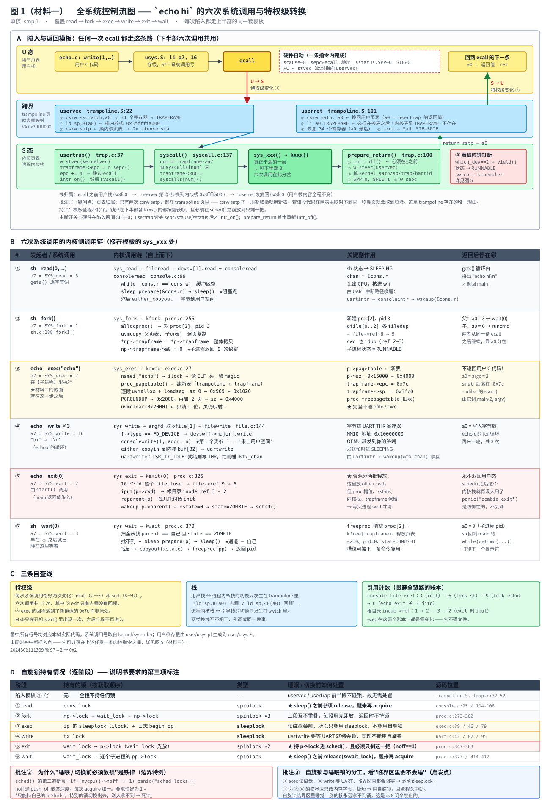

# 材料一：`echo hi` 全系统控制流

## 读图前的三个约定

本图以本机 `lab0/xv6-riscv` 参考树为依据，假设单核、没有重定向、只有 init、sh 和本次 echo 子进程。图中的阶段表示一条典型因果路径，不表示每次运行的绝对时间顺序都完全相同。键盘输入可能在 Shell 睡眠前后到达；若缓冲区已有完整一行，`read` 就不必睡。

- **U 态、用户栈**：运行 `user/sh.c` 或 `user/echo.c` 时。
- **S 态、进程内核栈**：该进程经 `ecall` 进入内核、运行 `usertrap` 和系统调用时。`uservec` 先在用户页表下保存寄存器，再从 trapframe 取 `kernel_sp` 换栈。
- **S 态、调度器栈**：进程阻塞或让出 CPU 后，`swtch` 切回 `scheduler()` 使用的每核启动栈。切换栈不等于切换特权级。

参考：`kernel/trampoline.S`、`kernel/trap.c`、`kernel/proc.c`、`user/sh.c`、`user/echo.c`。

## 从回车到输出的调用链

| 阶段 | 核心路径 | CPU / 栈 / 自旋锁 |
| --- | --- | --- |
| Shell 等输入 | `gets → read(0,&c,1) → ecall → uservec → usertrap → syscall → sys_read → fileread → consoleread` | U→S；sh 用户栈→sh 内核栈；`consoleread` 短暂持 `cons.lock` |
| 缓冲区空 | `sleep_prepare(&cons.r)`，放 `cons.lock`，`sleep → sched → swtch` | S；sh 内核栈→调度器栈；跨 `swtch` 只持 sh 的 `p->lock` |
| 按回车 | UART 接收中断，经 `kernelvec → kerneltrap → devintr → uartintr → consoleintr`；完整一行后 `wakeup(&cons.r)` | 若调度器空闲：S、调度器栈；`consoleintr` 持 `cons.lock`，唤醒时短暂持目标 `p->lock` |
| Shell 继续 | 调度器选中 sh；`consoleread` 返回一个字节；`gets` 反复调用 `read` 拼成 `echo hi\n` | S→U；sh 内核栈→sh 用户栈；返回用户态前无锁 |
| 创建子进程 | `fork → sys_fork → kfork`；复制用户内存、trapframe 和 `ofile[]` | U→S→U；sh 内核栈；短暂持新进程的锁与 `wait_lock` |
| 父子分路 | 父 `fork` 返回子 pid，调用 `wait(0)`；子 `fork` 返回 0，运行 `runcmd(parsecmd(...))` | 父等待可睡眠；子继续在 U 态用户栈执行 |
| 子进程换镜像 | `exec("echo") → sys_exec → kexec`，新建用户页表并加载 ELF，设置新的用户 `epc` 和 `sp` | U→S→U；子进程内核栈→新用户栈；`exec` 不新建进程，不清空 `ofile[]` |
| 输出 `hi` | `echo main → write(1,"hi",2) → sys_write → filewrite → consolewrite → uartwrite → UART THR` | U→S→U；echo 的用户/内核栈；UART 写路径使用可睡眠的 `tx_lock` |
| 输出换行 | `echo main → write(1,"\n",1)`，重复同一条内核输出链 | U→S→U；echo 的用户/内核栈 |
| 退出与回收 | `exit(0) → kexit` 关闭文件并成为 `ZOMBIE`；父进程 `wait → kwait → freeproc` 回收页表和进程槽 | echo 内核栈→调度器栈→sh 内核栈；切换时仅持被切换进程锁 |

`echo.c` 中只有一个命令行参数 `hi`。它先 `write` 两字节 `hi`，最后再 `write` 一个换行字节，**一共两次 `write`**。键盘输入阶段的回显也会显示 `echo hi`，但那是 `consoleintr → consputc` 的输入回显，不是 echo 程序输出。

## 每次系统调用共用的跨界模板

1. 用户函数调用 `usys` 存根，存根把系统调用号放入 `a7` 后执行 `ecall`。
2. 硬件从 U 切换到 S，把用户 PC 写进 `sepc`，原因码写进 `scause`，PC 跳到 `stvec` 指向的 `uservec`。此时还没有自动换成内核栈。
3. `uservec` 将用户寄存器保存到该进程的 trapframe，装入 `kernel_sp`，切换到内核页表后进入 `usertrap`。
4. `usertrap` 保存 `sepc`。只有系统调用分支将保存的 `epc` 加 4，以跳过 `ecall`；时钟中断不能这样做。`syscall` 从 `a7` 找到处理函数，返回值写入 trapframe 的 `a0`。
5. `prepare_return` 配好下次陷入入口、用户返回地址与 `sstatus`；`userret` 换回用户页表并恢复寄存器；`sret` 从 S 返回 U。

## 三个容易被追问的机制

- **为什么 Shell 的 `read` 会睡？** `consoleread` 只有在接收缓冲区没有可读完整行时才睡。`sleep_prepare(&cons.r)` 先登记等待通道；UART 中断收到换行后 `wakeup(&cons.r)`，把等待者变为 `RUNNABLE`。如果在放锁与真正睡下之间被唤醒，`sleep()` 会检查已清除的通道并直接返回，从而不丢唤醒。
- **为什么父子从同一位置继续，返回值却不同？** `kfork` 复制父进程保存的寄存器现场，再把子 trapframe 的 `a0` 改为 0；父进程的系统调用返回子 pid。因此两者从 `fork` 后继续，但执行不同分支。
- **为什么输入中断不一定走 `uservec`？** 入口由中断到来时的 CPU 状态决定。Shell 睡着、CPU 在调度器栈上等待时，UART 中断进入 `kernelvec`，不是 `uservec`。这时没有从用户栈换到进程内核栈的步骤。
