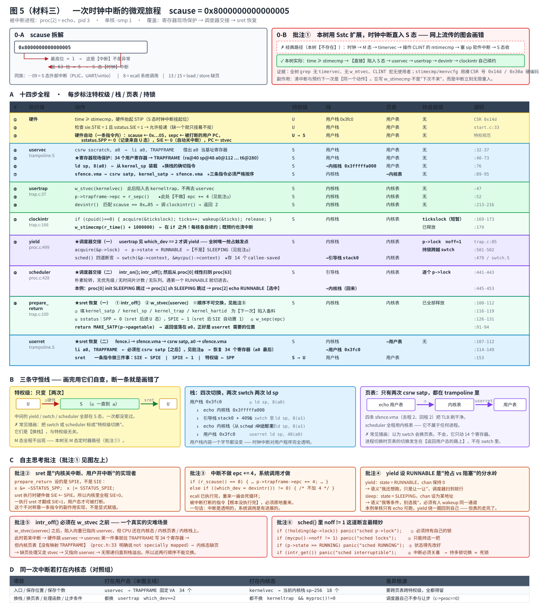

# 材料三：一次时钟中断的微观旅程



设单核上的 echo 正在 U 态执行。该参考树启用 Sstc，使用 `stimecmp` 产生 S 态时钟中断；中断原因是 `scause = 0x8000000000000005`。最高位 1 表示**中断**，低位 5 表示 **S 态时钟中断**。这里不经过旧版 xv6 的 M 态 `timervec/CLINT` 转发路线。参考 `kernel/start.c`、`kernel/trap.c`、`kernel/trampoline.S`。

## 从中断到 sret

| 步骤 | 发生的事 | 特权级 / 栈 / 页表 / 锁 |
| --- | --- | --- |
| 1. 硬件陷入 | `time >= stimecmp`；CPU 保存用户 PC 到 `sepc`，写 `scause`，`SPP=0`，暂时关闭 S 中断，跳 `stvec=uservec` | U→S；此刻 `sp` 仍是 echo 用户栈；仍用用户页表；无锁 |
| 2. 保存用户现场 | `uservec` 借 `sscratch` 保住 `a0`，把用户通用寄存器保存到当前进程的 `TRAPFRAME` | S；尚未换栈；用户页表；无锁 |
| 3. 换栈和页表 | 从 trapframe 的 `kernel_sp` 载入 `sp`；读 `kernel_satp` 并切到内核页表，随后调用 `usertrap` | S；echo 内核栈；内核页表；无锁 |
| 4. 识别中断 | `usertrap` 改 `stvec=kernelvec`，保存 `sepc` 到 `p->trapframe->epc`；`devintr` 识别原因 5 | S；echo 内核栈；内核页表；无锁 |
| 5. 处理时钟 | `clockintr` 中 hart0 增加 `ticks` 并 `wakeup(&ticks)`，随后 `w_stimecmp(r_time()+1000000)` 预约下一次 | S；echo 内核栈；`tickslock` 只在更新计数时短暂持有 |
| 6. 让出 CPU | `devintr` 返回 2，`usertrap` 调用 `yield`；echo 从 `RUNNING` 改为 `RUNNABLE`；`sched → swtch` 保存其内核上下文 | S；echo 内核栈→调度器栈；跨切换只持 echo 的 `p->lock` |
| 7. 调度决策 | `scheduler` 线性查找 `RUNNABLE` 进程并选中一个；可能再次选 echo，也可能先选别的进程 | S；调度器栈→被选进程的内核栈；选中时持该进程锁 |
| 8. echo 恢复 | echo 再次获选后从 `sched` 调用中途继续，返回 `yield` 和 `usertrap`；`prepare_return` 配置用户陷入入口、`sepc`、`SPP=0`、`SPIE=1` | S；echo 内核栈；内核页表；离开调度临界区后无锁 |
| 9. 返回用户态 | `userret` 换回 echo 用户页表、从 trapframe 恢复寄存器和用户 `sp`，最后 `sret` 返回保存的用户 PC | S→U；echo 用户栈；用户页表；无锁 |

`uservec` 保存的是用户被打断时的寄存器现场；`swtch` 保存的是内核函数调用上下文。两次保存目的不同，不能把 `swtch` 画成“保存全部用户寄存器”。`sret` 才负责从 S 态返回 U 态；`swtch` 只在 S 态进程内核栈与调度器栈之间切换。

## 三条校对线

```text
特权级： U ──硬件陷入──> S ──sret──> U
栈：     用户栈 ──uservec──> echo 内核栈 ──swtch──> 调度器栈
                        <──swtch── echo 内核栈 <──userret── 用户栈
页表：   echo 用户页表 ──uservec/satp──> 内核页表 ──userret/satp──> echo 用户页表
```

如果调度器先运行别的进程，echo 的 trapframe 与内核栈现场保持不变，直到它下一次被选中，才继续后半程。因此“`yield` 后立刻返回同一个进程”只是一种可能，不是硬件保证。

## 三个容易被抽问的原因

- **为什么这里不把 `epc` 加 4？** 时钟中断可能打在任意指令前后，必须从硬件保存的位置原样继续。只有 `ecall` 系统调用才要跳过自身，所以 `usertrap` 只在 `scause==8` 分支加 4。
- **为什么 `yield` 把状态设为 `RUNNABLE`，不是 `SLEEPING`？** echo 没有等待资源，只是让出这一轮 CPU；调度器下一次看见它就可以直接再选它，不需要 `wakeup`。
- **为什么 `prepare_return` 先关中断？** 它要把 `stvec` 改成下一次用户态陷入所用的 `uservec`。在仍处于内核状态时如果中断再次进入 `uservec`，入口和当前页表/栈不匹配，可能再次异常，所以必须先关中断再修改入口。

## 与内核态被时钟打断的区别

若时钟中断打在 S 态代码（包括调度器）上，入口是 `kernelvec`，在**当前内核栈或调度器栈**上保存现场，不走用户态的 `uservec/TRAPFRAME` 换栈换页表路线。`kerneltrap` 只有在 `myproc()!=0` 时才可能 `yield`；调度器自身没有当前进程，不能调用 `yield`。
