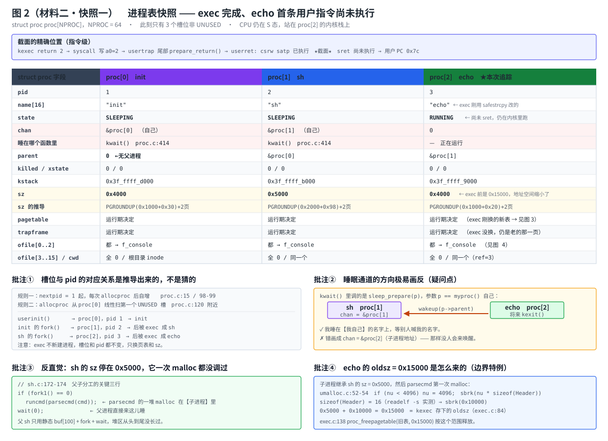
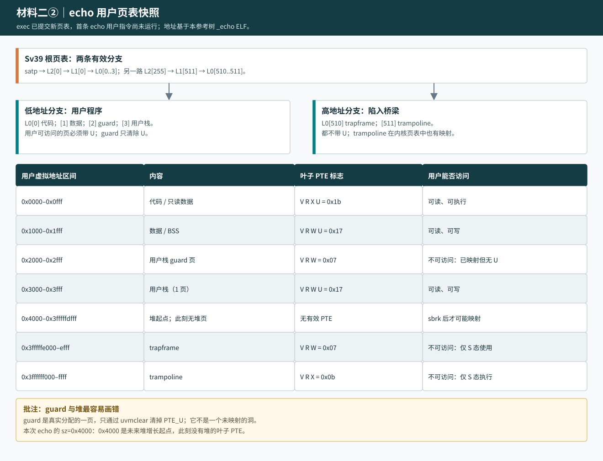
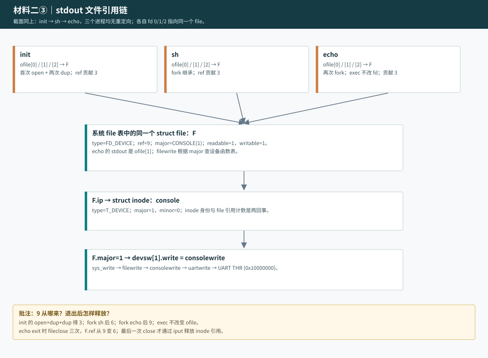

# 材料二：`exec` 后、echo 首次返回用户态前的快照

本材料的截面定在子进程 `kexec("echo", argv)` 成功替换用户镜像后、echo 的首条用户指令执行前。CPU 仍在该子进程的 S 态内核路径中。下面的 pid、槽位和文件引用数针对**单核、无重定向、没有额外子进程**的一次典型运行；指针物理地址由运行时分配，不能背成常数。`exec` 不创建新进程，只替换原子进程的用户页表、`sz`、用户 PC 和栈。

## 1. 进程表快照



| 进程 | pid | state / parent | kstack 基址 | pagetable | sz | ofile[0..2] |
| --- | --- | --- | --- | --- | --- | --- |
| init，示例 `proc[0]` | 1 | `SLEEPING`，无父进程；在 `wait` 等 sh | `0x3fffffd000` | 独立的 `P_init` | `0x4000` | 均指向 `F` |
| sh，示例 `proc[1]` | 2 | `SLEEPING`，parent=init；在 `wait` 等 echo | `0x3fffffb000` | 独立的 `P_sh` | `0x5000` | 均指向 `F` |
| echo，示例 `proc[2]` | 3 | `RUNNING`，parent=sh；仍在 `sys_exec/usertrap` 内 | `0x3fffff9000` | 新建的 `P_echo` | `0x4000` | 均指向 `F` |

`ofile[3..15]` 在这个无重定向场景中为空。`pagetable` 字段是真实的页表指针，但地址由分配器决定，图中的 `P_init/P_sh/P_echo` 只是区分三张不同页表。`kstack` 是进程内核栈的**页基址**，其值由 `KSTACK(i)` 算出；栈顶还要在这个值上加 `PGSIZE`。`sz` 数值来自本机参考树的 `_init`、`_sh`、`_echo` ELF 段末尾，经 `PGROUNDUP` 再加 guard 页和一页用户栈算出；若重新编译参考程序，必须重新核对。参考 `kernel/proc.h`、`kernel/proc.c`、`kernel/exec.c`、`kernel/memlayout.h` 与 `readelf -l user/_echo`。

## 2. echo 用户页表快照



Sv39 使用 L2→L1→L0 三级页表。本例根页表只有低地址和最高地址附近两条需要的路径：

```text
L2[0]   → L1[0]   → L0[0..3]       用户代码、数据、guard、用户栈
L2[255] → L1[511] → L0[510..511]   trapframe、trampoline
```

| 虚拟地址 | 内容 | 有效叶子权限 | 用户可访问？ |
| --- | --- | --- | --- |
| `0x0000–0x0fff` | 代码和只读数据 | `V R X U = 0x1b` | 是，读/执行 |
| `0x1000–0x1fff` | 数据和 BSS | `V R W U = 0x17` | 是，读/写 |
| `0x2000–0x2fff` | 用户栈 guard | `V R W = 0x07` | 否，缺 `U` |
| `0x3000–0x3fff` | 一页用户栈 | `V R W U = 0x17` | 是，读/写 |
| 从 `0x4000` 向上 | 将来堆的起点 | 当前无堆页 PTE | 此刻不能访问 |
| `0x3fffffe000–0x3fffffefff` | trapframe | `V R W = 0x07` | 否，缺 `U` |
| `0x3ffffff000–0x3fffffffff` | trampoline | `V R X = 0x0b` | 否，缺 `U` |

`trapframe` 和 `trampoline` 在每个进程的用户页表中占相同**虚拟地址**；前者指向各自独立的物理页，后者指向共享的 trampoline 代码页。`trampoline` 也映射在内核页表中，以便切换 `satp` 时继续取指。

特别注意：guard 页**已经分配并有效映射**。`exec.c` 先为它分配物理页，`uvmclear` 再清除 `PTE_U`，使用户态不能访问。它和完全没有映射的堆空洞不是同一种情况。`sz=0x4000` 是本次镜像的当前大小，不代表 `0x4000` 已有堆页。参考 `kernel/vm.c` 的 `uvmalloc/uvmclear`、`kernel/proc.c` 的 `proc_pagetable`、`kernel/memlayout.h`。

## 3. 文件表快照



```text
init.ofile[0,1,2] ─┐
sh.ofile[0,1,2]   ──┼──→ 同一个 struct file F（FD_DEVICE, ref=9, major=1）
echo.ofile[0,1,2] ─┘               │
                                   ├── F.ip → console 的 struct inode（T_DEVICE, major=1）
                                   └── F.major=1 → devsw[1].write=consolewrite
                                                    → uartwrite → UART THR
```

`init` 首先 `open("console", O_RDWR)`，再 `dup(0)` 两次，得到 fd 0/1/2，此时 `F.ref=3`。fork 出 sh 时三个 fd 各 `filedup` 一次，变成 6；sh fork 出 echo 再加三次，变成 9。`exec` 不改 `ofile[]`，所以 echo 的 `write(1,...)` 仍能通过 `ofile[1]` 到达控制台。sh 启动时临时打开再关闭 fd 3 不改变这张快照的最终引用数。

`struct file` 是一次打开的文件对象，`struct inode` 是文件系统中的 console 设备节点，两者不能混作同一个对象。`F.ref=9` 统计的是对**这个 file 对象**的九个 fd 引用，不是 inode 的引用数。echo 退出时三次 `fileclose` 把 `F.ref` 降至 6；只有最后一个 file 引用关闭时，才会 `iput(F.ip)`。参考 `user/init.c`、`kernel/proc.c` 的 `kfork/kexit`、`kernel/file.c`、`kernel/sysfile.c`、`kernel/console.c`。

## 验收时最重要的三个纠错点

1. `exec` 换的是用户程序镜像，不换 pid、进程槽或已经打开的 fd。
2. guard 页“有映射但无用户权限”，堆区“此刻没有映射”，两者不能画成同一种空白。
3. `ofile[1] → struct file → inode` 是引用链；`filewrite` 再根据设备主编号 `major=1` 找 `devsw[1].write`，最终才到 UART。
