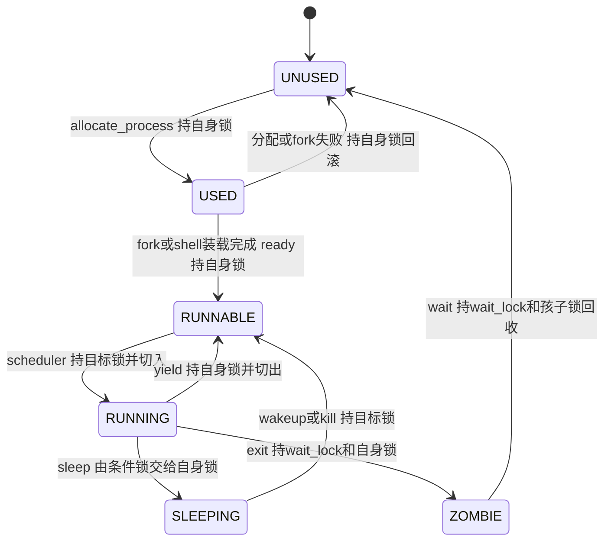
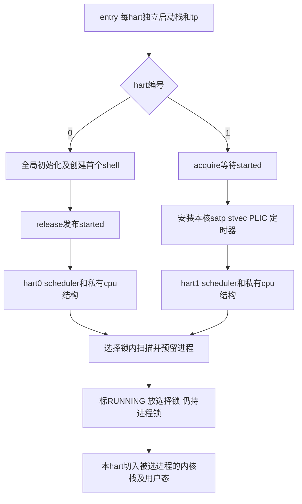

# Lab4 任务要求与对应代码讲解

依据：[实验4 进程上下文切换与调度策略 V3](lab4-实验说明书-学生版-V3.docx)和[增量包能力目标](能力目标与接口约定.md)。本文沿用 [Lab3 讲解](../lab3/Lab3完整调用图与操作系统作用讲解.md)的阅读主线：**实验要求什么 → 为什么需要 → 哪些文件实现 → 每一步做什么 → 验收如何解释。**

本实验在 Lab3 的独立页表之上，补齐能保存内核执行现场的上下文切换、每进程锁、休眠唤醒和时钟抢占，再实现学号 `2024302111309` 对应的 **ID 9：两级优先级与每等待 8 tick 老化一级**。同一个内核镜像支持单核和双核；默认单核保留策略基线，双核进一步检查两个调度器并发使用进程表、物理内存和外设的正确性。双核实现集中见第十节。

## 一、实验究竟要改变什么

Lab3 主要回答“一个进程可以访问哪些内存”。Lab4 进一步回答“现在让哪个进程使用 CPU，暂停的进程以后从哪里继续”。这两件事需要配合：切到 B 时，既要恢复 B 的执行现场，也要在返回用户态时采用 B 的页表。

重构前的本工程，比说明书中“常见 Lab3 起点”还要简化：只有 4 个进程槽，没有真正的 `context` 和 `scheduler()`；`proc_yield()`、`wait()` 等通过用户 `trapframe` 直接跳去另一个进程，丢弃临时的内核 C 调用链。这样的方式无法支撑一般函数中途休眠后继续，也无法容纳课程测试同时创建的 8 个孩子。

现在要做到：

1. A 在 `pause()`、`wait()`、控制台读等内核函数里可以停住，以后仍从原来的函数继续。
2. 两个只做计算、不主动休眠的进程，也能被时钟轮流打断。
3. 等事件的进程真正进入休眠；事件到达后被唤醒，且不会错过通知。
4. 高优先级优先运行，同时让长期等待的低优先级进程最终得到 CPU。
5. `CPUS=2`时两个hart各自在独立的启动栈和CPU结构上调度，安全共享进程表，且都实际执行用户负载。

### 1.1 哪些是机制，哪些是策略

| 部分 | 解决的问题 | 本工程位置 |
|---|---|---|
| 用户陷入与返回 | 用户寄存器、特权级和页表怎样保存及恢复 | [trampoline.S](../../kernel/trampoline.S)、[trap.c](../../kernel/trap.c) |
| 内核上下文切换 | 一个内核调用链怎样暂停、以后继续 | [swtch.S](../../kernel/swtch.S)、[proc.h](../../kernel/proc.h) |
| 调度机制 | 让出、休眠、唤醒、退出和锁怎样衔接 | [proc.c](../../kernel/proc.c)、[spinlock.c](../../kernel/spinlock.c) |
| 调度策略 | 就绪进程中谁先运行 | `scheduler()`、`proc_clock()`、`ready()` |
| 用户观测 | 怎样在用户程序里证明行为正确 | [syscall.c](../../kernel/syscall.c)、[priority_test.c](../../user/priority_test.c) |

`swtch()` 不知道票数、优先级和老化；它只保存与恢复寄存器。`scheduler()` 决定选择谁，然后使用 `swtch()` 执行决定。

## 二、准备任务与本人的参数

### 2.1 先接入课程包，再处理本地兼容

课程 `gifts/` 原件保存在 [Lab4 增量材料](gifts/Makefile.upgrade)中；`swtch.S` 按原件接入。课程用户库声明、系统调用号与桩加入工程，`common`、`bench`、`lottery_test`、`stride_test` 原样接入用户程序。

[Makefile](../../Makefile)新增内核目标文件和 `UPROGS`，沿用已有内嵌镜像构建链。用户程序仍通过名字从内嵌表加载，没有新增磁盘或文件系统。课程规定的 `qemu`、`clean` 命令保持原有入口。

有一个必须处理的编号冲突：Lab3 本地扩展 `dump_pagetable` 原用 23，Lab4 课程规定 `schedstat` 必须是 23。因此 [vm_debug.h](../../kernel/vm_debug.h)将页表扩展迁到 **27**，并重新编译调用它的 `pagedump`。课程 23、24、25 的接口含义保持课程规定。

本地新增 `setpriority` 使用 **26**，用于设置本人的两级基本优先级；双核观测 `smpstat`使用 **28**。它们追加在课程接口之后，没有改动 `gifts/` 内的原件。

### 2.2 学号参数不能只看旧注释

```text
COURSE_SID       = 2024302111309
LAB4_POLICY_ID   = 9
LAB2_TICK        = 2
默认 tickets     = 7 + COURSE_SID % 13 = 17
```

[course_sid.h](../../kernel/course_sid.h)中的策略注释是早期占位说明；**数值 9 的含义以 Lab4 V3 分配表为准**：两级优先级，数值较大的优先，每等待 8 tick 提升一级。这里不实现彩票份额，也不能拿彩票的 3:1 比例判据验收 ID 9。

### 2.3 本工程 tick 的口径

`trap.c` 每次时钟中断重新设置 `stimecmp = r_time() + 100000`。QEMU virt 的 `time` 为 10MHz，因此理想情况下相邻中断约 10ms；中断屏蔽及处理开销会影响实际间隔，不能把它当成精密墙上时钟。

**每个hart都有自己的时钟中断。** 全局 `ticks`只由hart0处理的用户态或内核态时钟中断推进；进程的 `cpu_ticks` 与 `last_slice_ticks`在它当前运行的hart上、仅从用户态进入的时钟分支累加。`LAB2_TICK=2` 表示累计两个用户态时钟 tick 后调用 `yield()`。这样双核不会使pause期限和8tick老化速度翻倍。

这使纯计算进程通常约每 20ms 发生一次调度机会。执行系统调用时命中的内核时钟会唤醒等待者、推进老化，但不增加该进程的用户 CPU 采样计数，也不在内核时钟分支抢占。

## 三、阶段一　每进程锁与上下文结构

### 3.1 实验要求

建立 `struct cpu`、每进程 `p->lock` 和 `struct context`，实现 `sched()`、`yield()`，使切换前后的锁和中断状态满足不变式。此阶段改动不能只覆盖 `yield()`：原有读控制台、`wait()`、`exit()` 也会进入 `sched()`，必须一起接入新的锁交接规则。

### 3.2 先分清两种现场

| 项目 | `trapframe` | `context` |
|---|---|---|
| 暂停的是什么 | 用户指令流 | 内核 C 调用链 |
| 保存位置 | 每个进程的 frame 物理页 | 每进程 `p->context`，以及每 CPU 的 `c->context` |
| 保存内容 | 用户 31 个通用寄存器、用户 PC 与内核入口参数 | `ra`、`sp`、`s0`～`s11`，共 14 个寄存器 |
| 搬运代码 | `uservec/userret`，C 管理 `epc` | `swtch.S` |
| 主要用途 | 用户态与内核态往返 | 进程内核栈与调度器栈之间切换 |

例如 A 调用 `pause(5)`：它的用户 PC 保存在 `A.frame->epc`，而暂停中的 `proc_pause → sleep → sched` 调用链在 A 内核栈中。`A.context.sp` 记录这条调用链所在的栈位置。

**trapframe 不会代替内核栈保存 C 函数的局部变量和返回链。** Lab4 引入 `context` 后，`sleep()` 返回时才有能力接着执行原来的下一行。

### 3.3 swtch 怎样不保存 PC 仍切换回来

RISC-V C 调用约定把两个参数放进 `a0`、`a1`：

```text
swtch(old, new)
    a0 = old 的地址
    a1 = new 的地址

把当前 ra、sp、s0..s11 写入 *old
从 *new 装回 ra、sp、s0..s11
ret：跳到刚恢复的 ra
```

`call swtch` 已把“调用结束后的下一条指令”放进 `ra`。保存这个 `ra`，就保存了以后继续执行的位置；恢复后 `ret` 跳回那条指令，因此不必单独保存一个 PC 字段。

这里需把课程的“14个寄存器”与严格ABI术语区分：**12个s寄存器和sp需要按调用约定保持，ra在ABI表中属于caller-saved；swtch额外保存ra，用它记录这条内核执行流的继续位置。** 不能把这14个全都称为callee-saved。分类可核对[RISC-V psABI整数寄存器约定](https://riscv-non-isa.github.io/riscv-elf-psabi-doc/#_integer_register_convention)。

`a0`～`a7` 和 `t0`～`t6` 属于调用者保存寄存器。编译器知道普通 C 函数调用会破坏它们，需要跨调用继续使用的值会先放在栈上或被调用者保存寄存器中。`swtch()`作为一次正常C调用点的切换，结合上述保存集合恢复执行流；它不能被误解为任意指令处保存完整硬件现场的陷入入口。

完整保存所有通用寄存器也能设计，但会增加保存、恢复和存储开销，还要定义与现有 C 调用方式一致的恢复协议；本实验使用课程 14 寄存器 ABI。

[proc.h](../../kernel/proc.h)对每个偏移与总长度使用编译期断言：`ra=0`、`sp=8`、`s0=16`，直至 `s11=104`，总计 112 字节。字段顺序与预置汇编必须完全相同。

### 3.4 cpu 和 proc 各保存什么

`struct cpu` 保存本 CPU 的调度器 `context`、当前进程 `proc`、关中断嵌套计数 `noff` 和进入最外层关中断区之前的状态 `intena`；另外累计本hart的分发次数和用户时钟采样，供双核观测使用。

`struct proc` 保存进程锁、状态、父指针、休眠通道、内核 `context`、页表、trapframe、内核栈，以及调度统计和优先级字段。进程表使用 [param.h](../../kernel/param.h)的 `NPROC=64`，不再把容量写死为 4。

`mycpu()` 使用内核 `tp` 中的 hart 编号索引 CPU；`myproc()`短暂关中断后取 `c->proc`。用户陷入时，`uservec` 从 trapframe 恢复内核 hart 编号；返回用户态前，`prepare_return()`重新填写 `kernel_hartid`。

### 3.5 自旋锁为什么同时管理中断

`acquire(lk)` 先 `push_off()`，再以原子交换获取锁。若同一 CPU 已持有这把锁，就立即 panic，避免悄悄死锁。

关闭中断是为了防止本 CPU 持锁时被中断处理程序打断，而中断处理程序又尝试获取同一把锁。此时被打断的代码无法继续释放锁，中断也无法前进。

`push_off/pop_off` 用 `noff` 记录嵌套，只有最外层退出才根据 `intena` 恢复中断。`holding(lk)`同时检查锁是否占用和持有者是否为当前 CPU；`release()`清除持有者、释放锁，再减少关中断嵌套。

### 3.6 sched 的四条不变式

```text
持有当前 p->lock
且 c->noff == 1
且 p->state != RUNNING
且中断关闭
    ↓
保存 intena
swtch(&p->context, &c->context)
    ↓ 将来本进程再次被选中
恢复 intena，继续原调用链
```

`noff==1`意味着进入切换前只有进程锁这一层关中断临界区。若还带着控制台锁、ticks 锁或 wait 锁切走，另一个进程可能必须拿这把锁才能唤醒当前进程，系统就可能停住。

`intena` 需要跟随这条被暂停的内核执行流保存。CPU 切走后会执行别的进程，其他执行流会改变 `c->intena`；不能把它们的值误用到恢复的 A 上。A可能在另一hart恢复，因此`sched()`返回后重新调用`mycpu()`，不能继续使用切出前缓存的CPU指针。

### 3.7 进程锁必须跨过 swtch

普通让出路径：

```text
A：acquire(A.lock)
   state = RUNNABLE
   sched → swtch(A.context, cpu.context)
                     ↓ CPU 已在调度器栈
调度器：swtch 返回，清空 c->proc
        release(A.lock)

以后调度器：acquire(A.lock)
            state = RUNNING
            swtch(cpu.context, A.context)
                     ↓ CPU 已在 A 内核栈
A：sched 返回
   release(A.lock)
```

锁保护的是“状态改变＋离开或进入内核栈”这一整个过程。若 A 在尚未离开自己的内核栈前就释放锁，另一个调度执行流可能看到 `RUNNABLE`，再次切进同一栈。

锁由同一个 CPU 上不同的内核执行流交接释放，是本实验有意设计的协议。

### 3.8 从未运行的新进程从哪里开始

`allocate_process()`在拿着新进程锁时申请 frame、内核栈和页表，设置：

```text
context.ra = forkret
context.sp = 私有内核栈顶
```

新进程第一次切入没有“之前的 `sched()`调用”可返回。`swtch()`恢复 `ra` 后直接到 `forkret()`，因此 **forkret 的第一步是释放 p->lock**，再通过 `usertrapret()`进入用户态。

`allocate_process()`先保持 `USED`，调用者完成镜像装载或 fork 复制后，才通过 `ready()`发布成 `RUNNABLE`，避免调度半成品。

## 四、阶段二　调度主循环与时钟抢占

### 4.1 调度器自己的栈在哪里

`entry.S`按hart编号划分独立8KB启动栈，`main → scheduler`一直使用本hart的启动栈；hart0先通过`proc_shell_init()`创建shell。`swtch()`把本hart调度器执行流保存在自己的 `c->context`，每个进程另有一页私有内核栈。

调度器栈不属于被切走的 A。A 退出后会被父进程回收内核栈；若调度器仍在 A 栈上运行，回收就等于拆掉调度器脚下的内存。

### 4.2 scheduler 每轮做什么

```text
短暂开中断，让待处理的 UART/时钟能够推进
 → 关中断，获取 scheduler_lock，扫描就绪进程
 → 按优先级和 rr_idx 选 best
 → 获取 best.lock
 → RUNNABLE → RUNNING，记录 c->proc
 → 清零 last_slice_ticks，更新本hart分发计数
 → 释放 scheduler_lock，仅保留 best.lock
 → swtch(cpu.context, best.context)
 → 进程让出、休眠或退出后，swtch 返回
 → 清空 c->proc，释放 best.lock
 → 下一轮
```

没有就绪进程时先释放选择锁，再执行 `wfi` 等待中断。扫描前有开中断机会，避免所有进程都睡着时，唤醒它们的时钟或串口事件一直无法处理。关中断只保护当前hart，无法阻止另一核访问进程表；双核的选择与预留由`scheduler_lock`和各进程锁共同保护。

`scheduler()`从 `swtch()`返回时，进程已由自己的 `yield/sleep/exit` 改好了状态。调度器不能把所有返回者一律改成 `RUNNABLE`，否则会把正在等事件的进程或僵尸错误地复活。

### 4.3 用户时钟抢占完整调用图

```text
A 在用户态计算
  ↓ 硬件时钟中断，sepc 记录用户断点
trampoline.S:uservec
  保存 A 的用户寄存器 → A.frame
  切换到 A 内核栈，加载内核页表，恢复内核 tp
  ↓
trap.c:usertrap → handle_user_trap
  保存 tf->epc
  proc_clock：仅hart0推进全局 ticks、唤醒定时等待、执行老化
  proc_user_tick：cpu_ticks++、last_slice_ticks++
  ↓ 若达到 LAB2_TICK=2
yield → sched → swtch(A.context, cpu.context)
  ↓
scheduler：锁内选择并预留 B，放选择锁后切入
swtch(cpu.context, B.context)
  ↓
B 从此前的 sched 返回，或第一次进入 forkret
usertrapret → prepare_return
  准备 B 的内核入口字段、stvec、sstatus、sepc
trampoline.S:userret
  写 B 的用户 satp，恢复 B 用户寄存器
  sret
  ↓
B 在自己的用户断点继续
```

以后 A 再被选中，会从 A 的 `sched()`返回，经过 `yield()`末尾、用户陷入处理末尾，最终恢复 A 的用户断点。时钟不是 `ecall`，所以时钟路径不会把 `epc` 加 4。

### 4.4 从 A 用户态到 B 用户态经过哪些栈

```text
A 用户栈
  ──uservec 加载 kernel_sp──→ A 内核栈
  ──swtch 恢复 cpu.context.sp──→ 调度器启动栈
  ──swtch 恢复 B.context.sp──→ B 内核栈
  ──userret 恢复用户 sp──→ B 用户栈
```

trapframe 和 context 是保存区域，不是这五段执行过程中的额外两套栈。用户寄存器 `sp` 与内核 `context.sp` 分别指向不同用途的栈。

### 4.5 内核时钟怎样处理

`kernel_trap_entry.S`在当前内核栈保存寄存器，调用 `kerneltrap()`。C 先保存 `sepc/sstatus`，处理时钟或 UART，最后恢复 CSR。当前实现只在用户时钟分支抢占；内核时钟分支推进 tick 和唤醒后返回原内核位置。

系统调用分支在记录好用户 `epc` 并换好内核陷入入口后允许中断，这样内核计算或处理阻塞调用时，时钟与串口仍能到达。临界区仍由自旋锁关闭中断保护。

## 五、阶段三　休眠唤醒与进程生命周期

### 5.1 为什么不能只有 yield

`yield()`表示“我还可以运行，只是现在让别人先运行”。`sleep()`表示“我要的条件还没满足，事件发生前不要反复选我”。

控制台没有输入时，反复让出后再检查会浪费 CPU。休眠后，调度器忽略它，UART 接收到字节时再把它改成就绪。

### 5.2 chan 是事件标识

`chan`不是队列对象，也不要求解引用；代码用地址作为“大家约定的同一个事件名”。

| 等待条件 | 条件锁 | 通道 | 唤醒方 |
|---|---|---|---|
| 控制台出现可读字节 | `input.lock` | `&input.r` | `console_input()` |
| tick 推进 | `tickslock` | `&ticks` | `proc_clock()` |
| 某个孩子退出 | `wait_lock` | 父进程指针 | 孩子的 `proc_exit()` |

醒来只说明“值得再检查条件”，不保证条件一定满足，所以 `read/pause/wait` 都在循环中检查。

### 5.3 丢失唤醒怎样发生

错误写法把释放条件锁放在获取进程锁之前：

```text
等待者 A                         事件生产者 B
持条件锁检查：条件不满足
释放条件锁
                                 获取条件锁，条件变为满足
                                 wakeup：A 还不是 SLEEPING，略过
                                 释放条件锁
获取 A.lock
A.state = SLEEPING
sched：以后若不再产生事件，A 永久睡眠
```

问题在于“最后一次检查”与“登记休眠”之间露出了一段无人保护的窗口。单纯增加 `wakeup()`次数不能建立正确性。

### 5.4 sleep 的正确锁交接

```text
调用者持条件锁 lk，确认条件不满足
  → acquire(p.lock)
  → release(lk)
  → p.chan=chan，p.state=SLEEPING
  → sched：此时仅持 p.lock
  → 被唤醒并再次调度后，sched 返回，仍持 p.lock
  → 清空 chan，release(p.lock)
  → acquire(lk)，返回调用者重查条件
```

在 A 释放条件锁之后，生产者可以更新条件，但它执行 `wakeup()`必须获取 A 的进程锁。A 已经持有这把锁，生产者无法越过“登记休眠＋离开内核栈”的交接。调度器释放 A 锁时，A 已是完整的 `SLEEPING`，唤醒方就能看到它。

`wakeup()`逐个拿目标进程锁检查状态与通道，匹配才通过 `ready()`改成 `RUNNABLE`。遍历跳过当前进程，避免对当前已持有的进程锁重入。

### 5.5 pause 如何避免忙等

```text
用户 pause(n)
 → ecall 13 → proc_pause(n)
 → acquire(tickslock)，记录 start=ticks
 → while ticks-start < n
      sleep(&ticks, &tickslock)
 → 满足 n tick 后解锁并返回 0

hart0每次时钟中断
 → proc_clock → ticks++ → wakeup(&ticks)
```

`pause(5)`可能被唤醒多次，每次重查经过的 tick；不足 5 就再次休眠。`pause(0)`直接成功，负数返回 -1，被 kill 的等待者检查标志后结束。

### 5.6 wait 与 exit 为什么额外需要 wait_lock

父子关系跨两个进程。若父亲持自己的锁再去拿孩子锁，而孩子持自己的锁再去拿父亲锁，就会形成互相等待。

本工程规定涉及父子关系的获取顺序是 **wait_lock → 进程锁**。父进程 `wait()`：

```text
验证用户状态指针
 → 获取 wait_lock
 → 扫描属于自己的孩子，逐个获取孩子锁
 → 找到 ZOMBIE：copyout 退出码，释放资源，返回 pid
 → 有孩子但还没退出：sleep(parent, &wait_lock)
 → 没孩子或自身被 kill：返回 -1
```

子进程 `exit()`：

```text
获取 wait_lock
 → 将自己的孩子交给 initproc
 → wakeup(parent)
 → 获取自己的 p.lock
 → 记录退出码，state=ZOMBIE
 → 释放 wait_lock
 → sched：仅持自己的锁，永不返回
```

虽然 `wakeup(parent)`写在设置自己 `ZOMBIE`之前，父亲醒来后仍须重新取得 `wait_lock`；它不可能越过孩子尚未完成的状态发布。这正是条件锁的作用。

`exit()`不能提前把 `c->proc`清空，`sched()`还要通过 `myproc()`找到正在退出的自己；它由调度器在切换返回后清空。

### 5.7 为什么 exit 不直接释放自己的栈

调用 `exit()`时 CPU 仍在该进程内核栈上。释放后继续执行 `sched()`，相当于仍使用已经归还的内存。正确分工是：

```text
exit：记录退出结果，成为 ZOMBIE，切走
wait：确认孩子 ZOMBIE 后，回收页表、用户页、frame、内核栈和进程槽
```

`release_process()`清理进程元数据时保留锁本身，避免把仍被持有的锁清零，然后无法正常释放。ZOMBIE 保留 pid、退出码和待回收资源，直到父亲 `wait()`。

### 5.8 kill 为什么只置标志

`proc_kill(pid)`设置 `killed`；目标若在休眠，就改为就绪，让它有机会醒来处理标志。用户陷入返回前，以及阻塞循环中会检查标志，并走正常 `exit(-1)`。

目标可能正在自己的内核栈上运行，或处在需要完成清理的系统调用中。由另一个进程直接释放其页表和栈会破坏这些执行现场，因此 kill 的请求和最终资源回收必须分开。

### 5.9 进程状态迁移图



`RUNNABLE`的优先级老化不会改变状态，只改变下一次选择时使用的有效优先级。

## 六、阶段四　观测接口与 ID 9 调度策略

### 6.1 系统调用与职责

| 调用 | 编号 | 本工程语义 |
|---|---:|---|
| `pause(n)` | 13 | 按全局 tick 休眠，成功 0，负数或被 kill 返回 -1 |
| `uptime()` | 14 | 返回全局已处理的 tick 数 |
| `schedstat(pid,&cpu,&slice)` | 23 | pid=-1 查自身；查询存活进程快照，成功 0，错误 -1 |
| `time_rdtime()` | 24 | 返回硬件 `time` CSR，单位不是 tick |
| `setickets(n)` | 25 | n≥1 记录并返回 0，非法值 -1；ID9 不按票数选人 |
| `setpriority(n)` | 26 | n=0低、1高；返回旧的基本优先级，非法值 -1 |
| `dump_pagetable()`本地扩展 | 27 | 保留 Lab3 页表观测，避开课程 23 号 |
| `smpstat(&stats)`本地扩展 | 28 | 用户输出指针先验证；返回在线掩码、每hart分发/用户采样及空闲页快照 |

用户调用经过 [usys.pl](../../user/usys.pl)生成的 `ecall` 桩，`a7`携带调用号，参数在 `a0/a1/a2`中，经 [syscall.c](../../kernel/syscall.c)分发到 `proc_*`函数。返回值最终写回 frame 的 `a0`，由 `userret`交还用户程序。

### 6.2 schedstat 的两种计数各是什么

`cpu_ticks`从进程创建后累计，只有用户时钟分支加一；`last_slice_ticks`在每次调度切入前清零，之后累计本次运行中命中的用户时钟 tick。

它们不是“运行了多少条指令”，也不是硬件 CPU cycle。系统调用密集的进程可能使用了一些内核时间，却很少被用户时钟采样到，因此测试使用纯计算内层循环。

采样其他进程时，`proc_schedstat()`持目标锁复制两个计数到内核局部变量，释放锁后再 `user_copyout()`。用户地址先用 Lab3 的 `user_writable()`验证；不存在、USED、ZOMBIE 或已经回收的目标均返回 -1。

拿到的是某个时刻的快照，函数返回后目标仍可能继续运行。比较份额时应取两个采样时刻的差值，不能要求每次采样都严格相等。

### 6.3 策略元数据及初始化

所有策略数据放在 `struct proc`中，用 `p->lock`保护：

| 字段 | 含义 | 初值或更新 |
|---|---|---|
| `base_priority` | 进程平常所属级别 | 初始 shell 为 1，fork 继承父亲，可由 `setpriority`修改 |
| `priority` | 调度器当前比较的有效优先级 | 通常等于 base，低级老化后临时变 1 |
| `ready_ticks` | 本次处于低级就绪状态的等待计数 | 新就绪时清零，每次全局 tick 递增 |
| `tickets` | 课程统一接口记录值 | 初始 17，fork 继承，可由 `setickets`覆盖 |
| `cpu_ticks/last_slice_ticks` | 用户态 CPU 采样统计 | 新进程为 0；slice 每次分发前清零 |

fork 不继承父亲已经获得的 CPU 计数，也不继承临时老化提升；孩子从自己的基本优先级和新计数开始。exec 更换用户镜像，不创建新进程，因此保留 pid、内核 context、基本优先级、票数及累计统计；用户寄存器和用户页表按 Lab3 的装载规则重建。

### 6.4 每等待 8 tick 提升一级怎样落到代码

`proc_clock()`在每次全局 tick 扫描进程表，逐个拿进程锁：

```text
若 state == RUNNABLE 且 priority == 0
    ready_ticks++
    若 ready_ticks >= 8
        priority = 1
        ready_ticks = 0
```

只计算 `RUNNABLE`等待：它已经准备好执行，只是没分到 CPU。等待串口、孩子或暂停期限的 `SLEEPING`进程没有在争用 CPU，不用这段时间积累老化。

低进程升到 1 后，会与其他高进程进入同级轮转；它得到一次调度机会后，调度器将有效优先级恢复为 `base_priority`。低进程下一次时间片耗尽再就绪，从 0 重新累计。这样能周期性给低进程服务，同时保持高优先级整体占优。

若系统中没有任何高进程就绪，低进程无需等满 8 tick 就可以直接被选中。老化是高进程持续竞争时避免饥饿的机制，不是人为给低进程强加最短等待时间。

### 6.5 同级为什么需要 rr_idx

如果每轮都从 `processes[0]`开始，在最高级里找到第一个就运行，低槽位可能一直获胜。

本工程保存上次选中的下标 `rr_idx`，下一轮从它后面开始环形扫描。只有找到**更高**优先级才替换当前候选；相同优先级保留扫描中先遇到的那个。因此：

```text
先比较有效优先级
同级按上次位置之后的环形顺序
```

没有另外维护链式就绪队列；每次扫描 `NPROC`个槽，结构直观，适合本实验规模。`rr_idx`由两个调度器共享，整个扫描、游标更新和RUNNING预留都在`scheduler_lock`内；标记后释放选择锁，另一核即可选择剩余RUNNABLE进程。每个进程自己的锁仍跨过swtch保护栈交接。

### 6.6 为什么不是固定 1:1 或固定 4:1

ID9 要求高优先级优先、低优先级最终获得服务，没有规定精确份额。实际采样会受时间片长度、父进程观察时机、就绪顺序、内核中断和系统调用开销影响。

单核策略验收应看到：高低竞争时高进程获得更多用户 CPU tick；低进程初期等待，老化后可以获得 CPU；同级竞争时两者都持续前进。将某次观测比例当作永远精确成立的理论常数是不正确的。双核能够同时运行两个孩子，两个孩子不再争用同一颗CPU，原单核份额与最短等待边界不适用。

## 七、Lab3 的页表与内存安全怎样继续参与

### 7.1 同一TRAPFRAME地址怎样对应不同进程

用户页表都把 `TRAPFRAME`映射到各自 frame。内核C通过 `myproc()->frame`的RAM地址访问正确的物理页；共享内核页表的高TRAPFRAME项固定指向旧boot探针页，正常调度不修改它，原`boot_trapframe_select()`已删除。

关键是跳板访问frame时使用哪张页表：`uservec`在切换到内核satp之前，就已通过A的用户页表保存寄存器并读出内核入口字段；`userret`先安装B的用户satp，再通过TRAPFRAME恢复B的寄存器。因此两核可同时访问“同一虚拟地址、不同物理frame”，不需要修改共享内核映射。若两核仍轮流改写共享TRAPFRAME项，单核时可用的别名选择就会变成互相覆盖的竞态。

### 7.2 fork 与 exec 的内存职责保留

fork 仍逐页复制用户页，保留权限和 guard 空洞，让父子数据相互独立；孩子有自己的 frame、页表和内核栈。exec 先完整建立新用户页表，成功后才替换旧表并释放旧用户页。

本次增加的是这些操作前后的进程状态发布和执行流切换。`wait()`回收时，页表树、用户页、frame 与内核栈仍由 Lab3 的分配/释放接口管理。

### 7.3 用户指针仍不能直接解引用

`wait(&status)`和 `schedstat()`都须把结果经 `user_copyout()`写回用户空间；`read()`消费输入前也先验证整个目标范围，避免坏指针导致内核异常或吞掉本应保留的输入。

`pagedump`直接检查这些地址映射是否仍正确；`badaccess`验证非法用户访问只终止出错进程，系统仍能继续运行并返回 shell。

## 八、自写用例怎样证明策略正确

本节的份额和等待边界固定使用`-smp 1`；双核用例见第十节。

### 8.1 alt 证明时钟能抢占纯计算

[alt.c](../../user/alt.c)创建两个孩子，各自执行有限的忙循环后打印 A 或 B，共各 16 个字符。父亲等待两者正常退出，再打印 `alt done`和 `PASS: alt`。

若没有时钟调度机会，通常是整串 A 后整串 B。验收脚本要求 A/B 的连续段多于两段，并核对 A、B 各 16 个，避免只看到两个字母就误认为发生了抢占。忙循环长度和主机速度会影响具体字符排列，不要求每个字符严格交替。

### 8.2 用例一　高低优先级 CPU 边界

[priority_test.c](../../user/priority_test.c)的观察父进程设为高优先级，创建高、低两个孩子。孩子先短暂休眠对齐，再进行纯计算；父进程休眠一段采样窗口，比较两个孩子 `cpu_ticks`的增量。

判据是采样总量足够、高进程增量超过低进程的两倍，且低进程增量大于 0。前两项证明优先级起作用，后一项证明高进程持续竞争时低进程仍获得服务。

### 8.3 用例二　观察耗尽时间片后等待老化再恢复

新建一个持续就绪的高进程，以及一个首次运行后自行将基本优先级设为 0 的孩子。低孩子记录 `uptime()`和自身 `cpu_ticks`，循环计算及采样，直到自己的用户 CPU tick 增加 2。

关键在于：第二次用户时钟到达时，内核已经先调用 `yield()`切走它。低孩子要执行下一次采样、发现自己完成了这两个 CPU tick，必须先等满就绪等待阈值、通过老化再次得到调度。因此它最后经退出码报告的耗时，同时包含**先前两个用户 CPU tick、之后至少 8 个就绪等待 tick，以及采样和调度边界**。

程序要求低孩子先于持续计算的高孩子完成，并要求耗时为 10～18 tick。当前版本单核复验实测为 **11 tick**，符合该路径；不能把它写成“老化计数恰好是11”，也不能要求每次正好等于2+8。若改成轮转，低孩子会过早恢复；若禁用老化，它会等到高孩子结束才能继续。这两种错误策略还用隔离对照验证。

### 8.4 补充用例　同级轮转与接口边界

同一观测程序再创建两个高优先级孩子，要求两者采样都明显大于 0，且差异在合理范围，检查 `rr_idx`是否避免固定槽位独占。

[schedcheck.c](../../user/schedcheck.c)验证自身与不存在 pid 的统计、非法用户指针、票数和优先级参数、`pause()`长度、负退出码、ZOMBIE拒绝观测、坏 wait 指针后的重试，以及 kill 休眠进程能被及时回收。

## 九、验收命令与证据阅读

在 WSL 的工程根目录运行：

```bash
python3 tools/run_lab4_checks.py
```

[验收脚本](../../tools/run_lab4_checks.py)会编译并启动真实 QEMU 单核串口会话，逐个执行程序，检查通过输出和 shell 恢复；随后调用课程 UART 注入器执行 [Lab4 回归输入](uart-regression.txt)。

| 证据 | 用途 |
|---|---|
| [smp-build.txt](evidence/smp-build.txt) | 本次单双核版本清理重建的编译与链接结果 |
| [checks.txt](evidence/checks.txt) | 查看本次各项检查、命令和退出码 |
| [runtime-serial.txt](evidence/runtime-serial.txt) | 对照原始终端输出，包括策略观测值 |
| [uart-regression.txt](evidence/uart-regression.txt) | 查看课程注入器的 UART 回归输出 |
| [vm-regression.txt](evidence/vm-regression.txt)、[对应串口](evidence/vm-regression-serial.txt) | 原 Lab3 运行验收：跨页、guard、fork/exec、重复 OOM、spin与shell并发 |
| [probe-regression.txt](evidence/probe-regression.txt) | 旧陷入探针：31寄存器与退出码7、0、-3 |
| [allocator-vm.txt](evidence/allocator-vm.txt) | 独立RISC-V分配器、页表OOM和回滚守恒检查 |
| [support-checks.txt](evidence/support-checks.txt) | 课程预置件完整性、跳板对齐与构建依赖 |
| [lost-wakeup.txt](evidence/lost-wakeup.txt) | 临时错误锁序的确定性交错复现 |
| [policy-controls.txt](evidence/policy-controls.txt) | 轮转和禁用老化两个错误策略的对照实验 |
| [smp-regression-summary.txt](evidence/smp-regression-summary.txt) | 双核改造后的支撑件、分配器、VM及反例复验汇总 |
| [smp-checks.txt](evidence/smp-checks.txt)、[双核串口](evidence/smp-runtime-serial.txt) | 三次独立双核启动、每核用户负载、并发与回归 |
| [单核兼容记录](evidence/smp-single-compat/smp-checks.txt) | 同一镜像在-smp 1下运行smptest与生命周期回归 |

课程 `bench`实际源码执行 100 轮 fork/exit/wait，再并发创建并回收 8 个混合负载孩子，要求两行 `RESULT`与 `PASS: bench`。说明书正文中的“16轮”“bench: PASS”等文字与赠送测试代码略有差异，验收记录按真实源码与真实输出解释。

`lottery_test`和 `stride_test`已接入构建，但它们的份额断言分别适用 ID3～5、ID6～7；本人的 ID9 策略使用 `priority_test`验收。运行它们并不等于要求 ID9 模拟其他策略。

当前版本清理重建后的单核复验结果为：

```text
RESULT avg_fork_wait = 6264
RESULT concurrent_children = 8
PASS: bench
RESULT priority_cpu = 48:12
RESULT aging_two_cpu_ticks_elapsed = 11 ticks
RESULT equal_priority_cpu = 24:24
PASS: priority ID9
```

`6264`的单位是硬件time计数/轮，不是tick；48:12是这次采样窗口的增量，高级占优且低级没有饥饿；24:24说明同级轮转，两者都推进。`alt`交错、`schedcheck`、6条课程UART EXPECT、完整Lab3运行回归、旧probe以及分配器/页表回滚均通过。重跑时允许具体计数变化。

### 9.1 在隔离版本中真实复现丢失唤醒

[check_lab4_lost_wakeup.py](../../tools/check_lab4_lost_wakeup.py)仅在临时目录生成错误 `proc.c`并链接故障镜像。它把sleep改成先 `release(lk)`，空转一百万次，再获取 `p->lock`；对wait条件另加一次 `yield()`，让孩子确实在“父亲尚未登记SLEEPING”的窗口中运行并退出。

加入这次 `yield()`是为了控制单核交错：本实现只抢占用户态，单纯在内核空转不足以保证孩子在窗口中被调度。故障日志记录 `FAULT: wait condition unlocked before SLEEPING`，随后bench首轮fork/wait阻塞，连第一行平均耗时都没有产生。

它验证的是指定交错中存在丢失唤醒，不把有限时间等待本身当成永久性的数学证明。正式 `proc.c`和 `kernel/kernel`没有被替换；正式版本的bench随后正常完成。复现命令：

```bash
python3 tools/check_lab4_lost_wakeup.py
```

### 9.2 两个策略对照排除误通过

[check_lab4_policy_controls.py](../../tools/check_lab4_policy_controls.py)同样仅构建临时镜像，保留切换、锁、时钟和休眠机制，只改策略：

- 改为同级轮转、忽略优先级：`bench`与`alt`仍通过；策略观测得到32:32，并被 `priority boundary missing`正确拒绝。
- 保留优先级、禁用老化：观测得到60:0，被 `low priority starved`正确拒绝。

这证明策略测试能区分“机制工作但没实现本人的策略”与正式ID9实现。日志还核对正式源文件、对象和镜像SHA256未改变。复现命令：

```bash
python3 tools/check_lab4_policy_controls.py
```

其他独立回归可运行：

```bash
python3 tools/check_lab4_vm_regression.py
python3 tools/check_exit.py
python3 tools/check_lab3_vm.py
```

临时故障和对照实验的 `FAIL`是预期拒绝结果；正式主验收日志中的 `FAIL`才表示交付实现未通过。

## 十、双核挑战怎样与单核共存

### 10.1 两个调度器与一份共享进程表

单核、双核使用相同源码和内核镜像，只改变QEMU启动的硬件线程数。`NCPU=8`是结构数组和启动栈的容量，`CPUS`才决定这次QEMU实际启动的核数；本次验证范围为1核和2核。Makefile设置`CPUS ?= 1`，将`-smp $(CPUS)`追加到QEMU变量，课程qemu配方保持原样。

```bash
make qemu CPUS=1
make qemu CPUS=2
```



hart0把分配器、内核页表、锁、设备和shell全部准备好，才原子release发布started。副核acquire观察到该值后，才能依赖这些共享数据；仅有普通volatile标志不足以表达完整的发布顺序。副核只做本核硬件初始化，不重复清空分配器或进程表，也不重印Lab1横幅。

### 10.2 说明书七项清单对应代码

| 清单 | 本工程实现 | 解决的问题 |
|---|---|---|
| 分核启动栈及放行副核 | [entry.S](../../kernel/entry.S)，`sp=boot_stack+(hart+1)*8192`，核号超过NCPU才停驻 | 两核不覆写同一启动栈 |
| tp在用户往返和内核中断中正确 | [start.c](../../kernel/start.c)写mhartid；[trap.c](../../kernel/trap.c)写当前kernel_hartid；[kernel_trap_entry.S](../../kernel/kernel_trap_entry.S)不从旧栈恢复tp | 迁移后继续索引当前hart的cpu结构 |
| 全局初始化与每核初始化屏障 | [main.c](../../kernel/main.c)的原子started；[boot_vm.c](../../kernel/boot_vm.c)分离建表与本核安装satp | 副核不读取半成品，也不重复全局初始化 |
| 锁归属核 | [spinlock.c](../../kernel/spinlock.c)的`locked && cpu==mycpu()` | 别核正常持锁不被误判为本核递归 |
| PLIC上下文和全局时间职责 | [plic.c](../../kernel/plic.c)按hart设置；[proc.c](../../kernel/proc.c)仅hart0推进ticks/aging | UART RX单生产者，睡眠及老化时钟不翻倍 |
| QEMU实际启动双核 | [Makefile](../../Makefile)默认CPUS=1并向QEMU传-smp | CPUS=2产生真实第二颗hart |
| 双核测试口径 | [smptest.c](../../user/smptest.c)、[双核脚本](../../tools/run_lab4_smp_checks.py)；策略比例仍单核 | 同时运行与单CPU份额的验证各有明确判据 |

内核现在只在用户时钟到达时间片时抢占。kerneltrap不调用yield；同时汇编主动不恢复旧tp，避免未来允许内核抢占后把旧核号带到新核。用户的tp仍由用户trapframe完整保存和恢复，不能把用户tp当作可信核编号。

### 10.3 为什么关中断之外还要加锁

hart0关中断只阻止hart0的中断处理程序，hart1仍可同时修改共享数据。选择过程因此增加`scheduler_lock`：扫描候选、更新rr_idx、锁住获胜者并将其标成RUNNING全部串行；标记完成后释放选择锁，再swtch。另一核看到RUNNING便不能重复选择同一进程。两个CPU可以并行执行不同进程，选择临界区本身仍是串行的。

选择锁不跨swtch，跨切换的仍只有当前进程锁，所以`sched()`的noff==1断言继续成立。进程在hart0暂停，可能由hart1恢复；被恢复的是进程的栈、ra和s寄存器，当前hart的tp不属于进程context。`sched()`重新获取mycpu恢复intena，用户返回再更新kernel_hartid，形成完整的迁移协议。

物理页分配也必须串行修改位图与计数：[kalloc.c](../../kernel/kalloc.c)先在锁内预留一页，再解锁清零；释放页在填充完成后才置为空闲。两核能够处理不同的页面，但不会同时得到同一页。UART发送的THRE检查、THR写入和发送计数由独立output_lock保护；它按字节串行，不保证多个进程的整行printf连续。

### 10.4 用什么证明确实两个核在工作

本地`smpstat`经用户指针检查和copyout提供：

- `online_mask`：每个scheduler上线时置自己的位，1表示hart0，3表示hart0与hart1。
- `dispatches[hart]`：该物理核分发进程的累计次数。
- `user_ticks[hart]`：该物理核实际从用户态处理的时钟采样总数。
- `free_pages`：物理分配器持锁取得的空闲页数。

掩码为3还不能独自证明第二核执行了用户程序。smptest比较前后快照，要求两个核的dispatches和user_ticks都增加，并检查未上线核的计数仍为0。计数按物理hart累计，进程迁移并不会把历史值移到另一核。

smptest每轮创建8个工作进程，执行并发sbrk、嵌套fork、父子写入不同数据、失败exec和成功exec hi、pause/唤醒、负退出码wait及坏指针后重试，共3轮。每轮等全部孩子回收后检查空闲页恢复到同一基线；最终释放父进程堆页后检查初始资源全部归还，另行kill睡眠孩子并及时回收。

程序还比较硬件time与全局uptime：正常每全局tick约100000个time计数，允许80000～120000的观测边界。若两核都推进ticks，比例接近50000，会被拒绝。这是确认“两个核各自有定时器”和“全局时间只计一次”同时成立的运行证据。

### 10.5 双核复现与结果解释

```bash
python3 tools/run_lab4_smp_checks.py
```

默认脚本启动三次独立的`-smp 2`QEMU。每次核对Lab1横幅只出现一次、运行smptest，再分批覆盖bench、alt、schedcheck、proctest、vmtest、memcap、badaccess、pagedump和hi，每条命令结束都必须恢复shell。证据在[smp-checks.txt](evidence/smp-checks.txt)、[smp-runtime-serial.txt](evidence/smp-runtime-serial.txt)，日志的PASS/FAIL和原始串口才是实测结论。

当前三次独立双核启动全部通过，online_mask均为3。具体统计为：

| 启动 | hart0 分发/用户采样 | hart1 分发/用户采样 | 全局ticks/硬件time增量 |
|---|---:|---:|---:|
| 1 | 164 / 106 | 131 / 99 | 123 / 13660056 |
| 2 | 118 / 102 | 176 / 99 | 125 / 13828550 |
| 3 | 151 / 101 | 145 / 103 | 124 / 13747746 |

每次smptest内部三轮并发工作后空闲页均回到32601；最后释放父进程6页堆空间后，恢复初始32607页。两核都有正的用户时钟采样增量，说明第二核确实执行了用户代码；输出中的分发次数、采样数和耗时不是要求未来重跑完全复现的常数。

单核主验收仍运行`python3 tools/run_lab4_checks.py`。smptest单核兼容也已通过：掩码1，仅hart0有统计增量，242次分发、112个用户采样，最终同样恢复32607页。独立记录在[单核兼容证据](evidence/smp-single-compat/smp-checks.txt)，复现命令为：

```bash
python3 tools/run_lab4_smp_checks.py --cpus 1 --rounds 1 --evidence-dir labs/lab4/evidence/smp-single-compat
```

只有两个计算孩子时，双核可让它们同时执行，因此不要求复现单核高低CPU比例，也不要求低孩子一定等待8tick才继续。老化规则仍存在；是否需要等待取决于当时是否有更多就绪竞争者。有限压力测试给出运行证据；每核状态、锁顺序和状态交接协议负责解释并发正确性。

## 十一、现场演示与常见追问

单核现场可以按以下顺序运行：

```text
hi
pagedump
badaccess
bench
alt
schedcheck
priority_test
```

每个有限程序结束后，应重新看到 `sh> `。shell 不支持 `&`后台语法；`spin`不会自行退出，演示抢占使用能回收孩子的 `alt`更方便。

**问：A 切到 B，A 的用户 PC 保存在哪里？内核恢复位置又在哪里？** 用户 PC 在 A.frame 的 `epc`，由陷入 C 代码记录；内核调用结束后的继续位置在 A.context 的 `ra`，栈位置在 `sp`。

**问：为什么新进程不是从 sched 返回？** 它还没有执行过 `sched()`，因此 `context.ra`预置为 `forkret`。首次释放进程锁的责任也落在 `forkret()`。

**问：为什么调度器从 swtch 返回后不直接把进程设为 RUNNABLE？** 返回者可能在等待输入、等待孩子或已经退出；状态由让出方按真实原因设好，调度器只结束当前占用关系并释放锁。

**问：wake 在 sleep 之前发生，一定是 bug 吗？** 如果条件已经满足，等待者持条件锁重查后根本不会睡；问题是检查完后释放条件锁，又没有用进程锁保护登记休眠的窗口。

**问：单核也需要这些锁吗？** 中断也能打断普通内核路径；更重要的是锁与中断关闭共同表达状态发布和跨执行流交接，确保休眠、唤醒与回收的顺序成立。

**问：低优先级是否永远只运行一个时间片？** 每次老化提升保证一次调度机会；若没有更高竞争者，即使回到低级也可继续被选中。不能把“提升后回 base”理解为强制停机。

**问：双核和单核会冲突吗？** 共用同一内核镜像，通过CPUS=1或2选择运行。每核状态独立、共享状态加锁和启动同步在单核同样成立；测试按核数解释，单核策略份额不要求在双核复现。

**问：怎样排除“只启动了一个核却称为双核”？** 直接检查QEMU的-smp 2参数、smpstat掩码3，以及两个hart均为正的用户时钟采样增量；再核对并发压力与资源回收，不只看结构体或启动横幅。

阅读源码时，先沿 `usertrap → proc_user_tick → yield → sched → swtch → scheduler`看一次抢占，再沿 `proc_pause → sleep → proc_clock → wakeup`看一次阻塞，最后看 `proc_wait/proc_exit`的资源交接，能把四个阶段连成一条实际运行路径。
